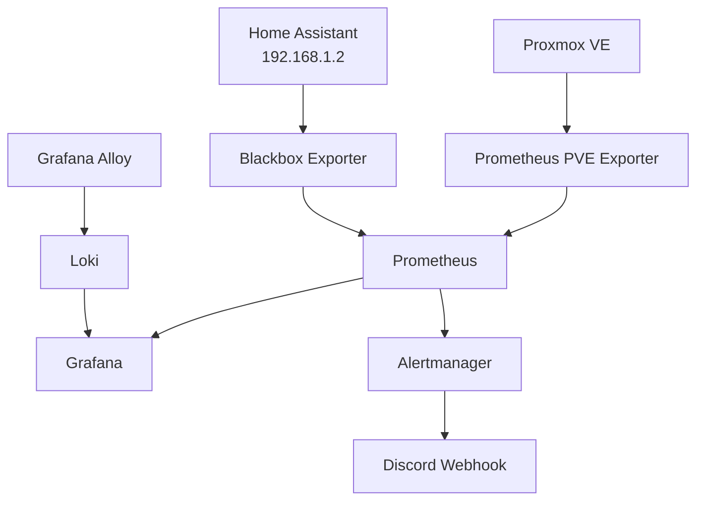

# Homelab Observability Platform

A self-hosted monitoring and alerting platform built to centralize infrastructure metrics, application availability, logs, dashboards, and notifications for a Proxmox homelab.

The project uses configuration-as-code for Prometheus alert rules, Grafana dashboards and data sources, Loki, Alloy, Blackbox Exporter, and Alertmanager.

## Architecture



## Components

| Component | Purpose |
|---|---|
| Prometheus | Scrapes metrics and evaluates alert rules |
| Prometheus PVE Exporter | Collects Proxmox VE metrics |
| Blackbox Exporter | Checks Home Assistant HTTP availability |
| Grafana | Visualizes metrics and logs |
| Loki | Stores and queries logs |
| Grafana Alloy | Collects Docker container logs |
| Alertmanager | Groups and routes alerts |
| Discord webhook | Delivers alert notifications |

## Environment

The current deployment runs in a Debian-based Proxmox LXC with Docker Compose.

| Service | Address |
|---|---|
| Grafana | `http://192.168.1.99:3000` |
| Prometheus | `http://192.168.1.99:9090` |
| Alertmanager | `http://192.168.1.99:9093` |
| Home Assistant | `http://192.168.1.2:8123` |

These addresses reflect the current homelab. Adjust them for other environments.

## Monitoring and alerting

The current Prometheus rules cover:

- Proxmox exporter availability
- Availability of expected-running Proxmox LXC guests
- High CPU usage on the Proxmox node
- High CPU usage on Proxmox guests
- Home Assistant HTTP availability

The stopped Kubernetes lab VMs, Ubuntu template, and inactive Proxmox Home Assistant VM are intentionally excluded from guest-down alerts.

Home Assistant is monitored separately through an HTTP probe. A failed probe must persist for two minutes before the critical alert fires.

Alertmanager sends notifications through a Discord webhook and can send resolved notifications as well.

## Configuration as code

Key configuration files:

```text
.
├── .env.example
├── .gitignore
├── compose.yaml
├── alertmanager/
│   └── alertmanager.yml
├── alloy/
│   └── config.alloy
├── blackbox/
│   └── blackbox.yml
├── grafana/
│   ├── dashboards/
│   │   └── home-lab.json
│   └── provisioning/
│       ├── dashboards/
│       │   └── dashboards.yaml
│       └── datasources/
│           └── datasources.yaml
├── loki/
│   └── loki-config.yaml
└── prometheus/
    ├── prometheus.yml
    └── rules/
        └── homelab.yml
```

Grafana dashboards and data sources are provisioned from files. Prometheus alert rules are stored alongside its scrape configuration.

## Deployment

### Prerequisites

- A Linux host or LXC with Docker Engine and Docker Compose
- Network access to the Proxmox API and Home Assistant
- A Proxmox API token with appropriate read-only monitoring permissions
- A Discord webhook if Discord notifications are desired

### 1. Configure environment variables

Create a local `.env` based on `.env.example` and fill in the real credentials:

```bash
cp .env.example .env
chmod 600 .env
```

Review every variable referenced by `compose.yaml` and ensure it has a valid value.

### 2. Configure the Discord webhook

Create `alertmanager/discord-webhook-url` containing only the webhook URL, on a single line. Restrict access to this file and ensure its ownership and permissions permit the Alertmanager container to read it.

Never commit this file or share its contents.

### 3. Review environment-specific settings

Update the Proxmox target, Home Assistant URL, node name, and any other environment-specific values in the configuration files.

Review the Proxmox exporter's TLS settings before deploying outside a trusted lab network.

### 4. Validate and start

```bash
docker compose config -q
docker compose up -d
```

Check service status and logs:

```bash
docker compose ps
docker compose logs --tail=100
```

### 5. Validate Prometheus rules

```bash
docker compose exec prometheus \
  promtool check rules /etc/prometheus/rules/homelab.yml
```

Open the Prometheus Targets page and verify that the Proxmox and Home Assistant targets are healthy.

## Security

- `.env` and the Discord webhook file are excluded from version control.
- `.env.example` contains placeholders only.
- Prometheus, Grafana, and Loki use Docker-managed persistent volumes in this deployment.
- Rotate credentials if they may have been exposed.
- Review network access controls before exposing any monitoring endpoint beyond the trusted LAN.
- TLS certificate verification for the Proxmox exporter is currently disabled in this lab configuration. This should be improved before production use.

## Persistence and recovery

Prometheus, Grafana, and Loki use Docker named volumes for persistent data. Alloy has a local state directory.

Back up the named volumes and configuration files according to your recovery requirements. A Git repository stores configuration, not the monitoring history or Grafana's live database.

## Roadmap

- [x] Proxmox metrics collection
- [x] Grafana dashboards provisioned from files
- [x] Centralized Docker logs with Alloy and Loki
- [x] Alertmanager with Discord notifications
- [x] Home Assistant HTTP availability monitoring
- [x] Alert rules excluding intentionally stopped guests
- [ ] Improve Proxmox TLS verification
- [ ] Document backup and restore testing
- [ ] Add a repeatable end-to-end alert test
- [ ] Add screenshots of dashboards and alert delivery

## License

Choose a license before publishing this repository. If you intend others to reuse the project, an OSI-approved license such as MIT is a common option.
