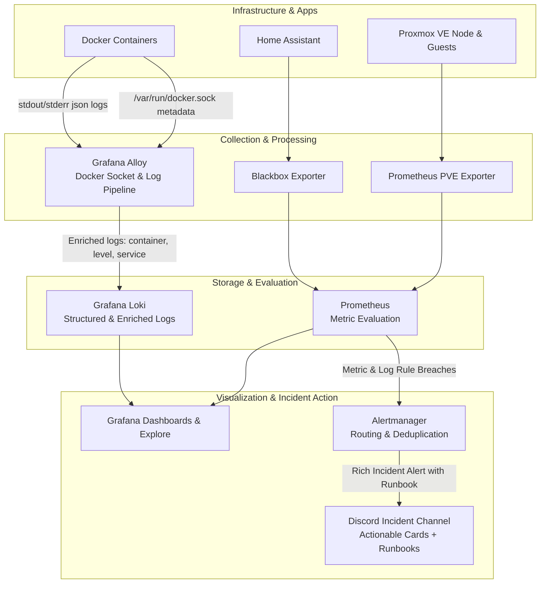

# Homelab Observability & Incident Response Platform

A production-grade, self-hosted observability and incident response platform built to centralize infrastructure metrics, microservice availability, enriched container logs, actionable alerts, and automated triage runbooks for a Proxmox homelab.

The stack uses configuration-as-code for Prometheus alert rules, Grafana dashboards and data sources, Loki, Alloy log pipelines, Blackbox Exporter, and Alertmanager with Discord incident notifications.

## Architecture & Data Flow



## Production Observability Highlights

- **Enriched Container Log Pipelines**: Unlike raw log scraping, Grafana Alloy interrogates `/var/run/docker.sock` to extract real container names and Compose service metadata. In addition, regex/template stages normalize log severity levels (`info`, `warn`, `error`, `critical`) into indexable Loki labels.
- **Actionable Alert Notifications**: Alerts delivered to Discord are not plain notifications. They follow production SRE principles by including:
  - Clear **Incident Severity & Summary**.
  - Direct **Runbook commands** (e.g., immediate diagnostic commands).
  - Remediation **Action steps** (e.g., safe restart commands).
  - Deep links directly into Grafana metrics or Loki filtered log views.
- **Log Spike & Health Rules**: Alongside infrastructure rules (CPU, guest availability, HTTP status), alert rules evaluate sustained bursts of error logs across containers (`ContainerErrorLogSpike`).
- **Secret Separation**: Sensitive tokens and webhooks (such as Discord credentials) are mounted strictly via container secrets/read-only bind mounts (`webhook_url_file`).

## Components

| Component | Role | Details |
|---|---|---|
| **Prometheus** | Metric collection & rule engine | Evaluates scrape targets and threshold alerting |
| **Grafana Loki** | Centralized log database | Indexing labels with TSDB schema and structured metadata |
| **Grafana Alloy** | Observability agent | Discovers Docker containers, extracts levels, ships to Loki |
| **Alertmanager** | Incident router | Groups alerts, inhibits duplicates, sends Discord runbooks |
| **Grafana** | Unified visualization | Pre-provisioned dashboards and correlated log exploration |
| **Blackbox Exporter** | Synthetic availability checks | HTTP probes against service endpoints |
| **PVE Exporter** | Hypervisor telemetry | Scrapes node and LXC/QEMU guest status from Proxmox |

## Production Incident Workflow (Triage in Action)

When an incident triggers:
1. **Detection**: Prometheus detects a breach (e.g. `HomeAssistantDown` or `ContainerErrorLogSpike`).
2. **Notification**: Alertmanager groups related alerts and posts a rich notification card to Discord:
   - Includes **Summary**, **Description**, **Runbook**, and **Remediation Action**.
3. **Investigation**: Engineer clicks the dashboard/log link directly to Grafana Explore to inspect correlated error traces.
4. **Resolution**: Once the condition recovers, Alertmanager dispatches a green `[RESOLVED]` confirmation card.

### Running an End-to-End Incident Simulation

To verify that the full incident response pipeline functions end-to-end:

```bash
# 1. Fire a test incident with actionable runbook
chmod +x scripts/test-alert.sh
./scripts/test-alert.sh

# 2. Check Discord to view the actionable incident card

# 3. Send a resolved notification to close out the test incident
./scripts/test-alert.sh resolve
```

## Repository Structure

```text
.
├── .env.example
├── .gitignore
├── compose.yaml
├── alertmanager/
│   ├── alertmanager.yml         # Alert routing & Discord incident templates
│   └── discord-webhook-url      # (Secret) Target webhook URL
├── alloy/
│   └── config.alloy             # Docker discovery, log parsing & level extraction
├── blackbox/
│   └── blackbox.yml             # HTTP probe modules
├── grafana/
│   ├── dashboards/
│   │   └── home-lab.json        # Pre-provisioned Homelab dashboard
│   └── provisioning/
│       ├── dashboards/
│       │   └── dashboards.yaml
│       └── datasources/
│           └── datasources.yaml
├── loki/
│   └── loki-config.yaml         # Retention, storage, and TSDB schema config
├── prometheus/
│   ├── prometheus.yml           # Scrape targets and rule file references
│   └── rules/
│       └── homelab.yml          # Availability, CPU, and log-based alert rules
└── scripts/
    └── test-alert.sh            # End-to-end alert verification utility
```

## Deployment & Verification

### 1. Apply Changes
On the host or LXC container:
```bash
docker compose config -q
docker compose up -d --remove-orphans
```

### 2. Verify Log Enrichment
In Grafana (`http://192.168.1.99:3000`), open **Explore** -> select **Loki** and query:
```logql
{job="docker"} | level = "error"
```
Or filter by container name:
```logql
{container="prometheus"}
```

### 3. Verify Prometheus Rules
```bash
docker compose exec prometheus promtool check rules /etc/prometheus/rules/homelab.yml
```

## Security

- `.env` and `alertmanager/discord-webhook-url` are kept outside version control.
- Docker containers run with read-only configuration mounts (`:ro`).
- Sensitive Alertmanager webhooks are read from isolated filesystem paths (`webhook_url_file`).
- Network ports are bound to internal management IPs (`192.168.1.99`).

